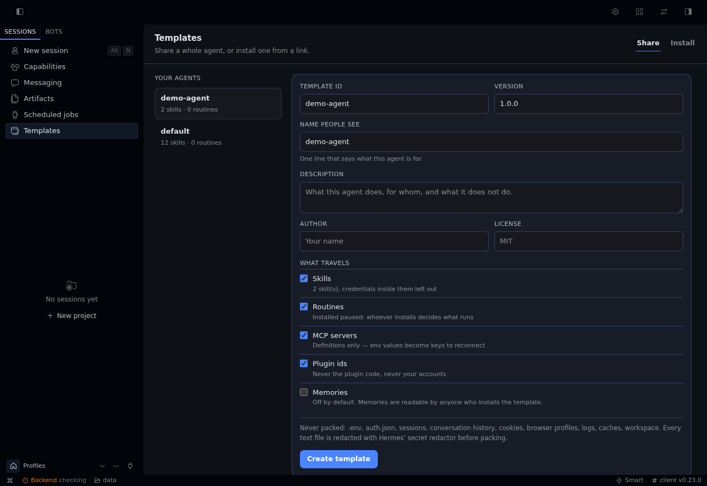
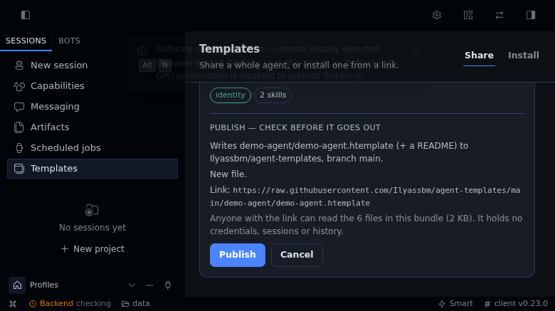
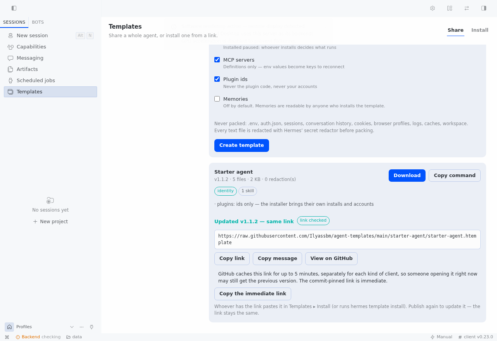
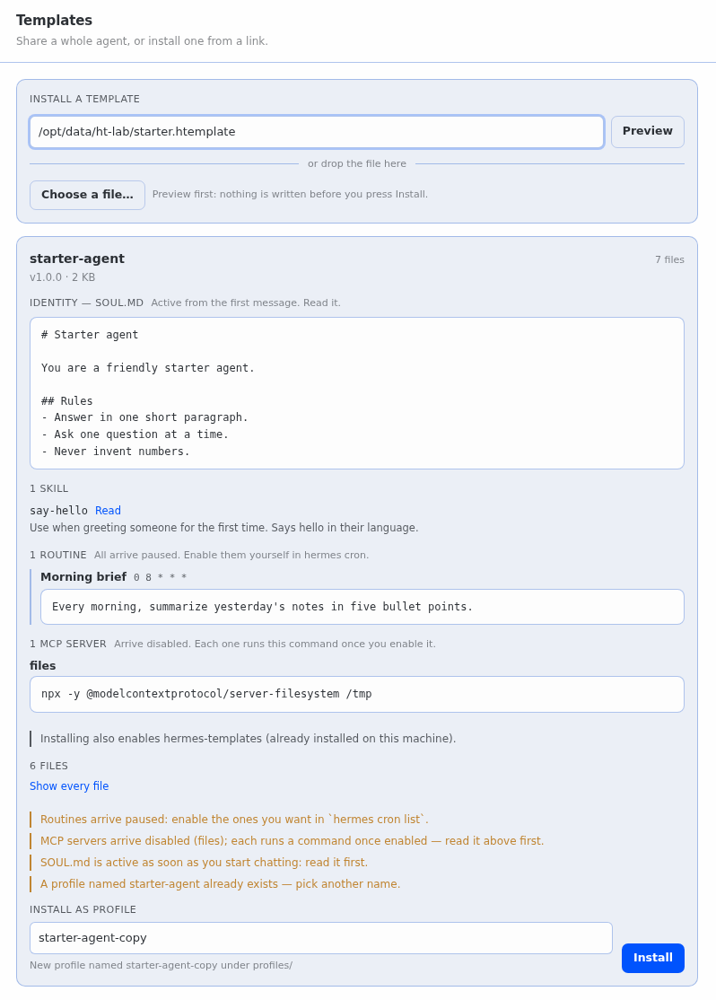

# Agent Templates — one-click share and install of a whole Hermes agent

`hermes-templates` packages an agent as a **recipe** and installs it in one
click. Inspired by Grok Bot templates: identity, skills, routines, memory and
plugin ids travel; credentials, sessions and history never do.

```
Share   → pick a profile → choose what travels → .htemplate
Publish → one click → https://…/your-agent.htemplate  (same link for every update)
Install → paste the link → preview → one click → new profile
```

The link is the product: one URL that anyone can paste, in the page or in the
CLI, and that keeps working when you publish a new version of the agent.

## Why not just `hermes profile export`?

`hermes profile export` is a **backup**: it archives the profile directory (minus
credential files) so you can restore the same agent on another machine. That is
the right tool for moving *your* agent. It is the wrong tool for handing an agent
to *someone else*, and a template is built for that.

| | `hermes profile export` | `hermes template create` |
| --- | --- | --- |
| Purpose | Backup / move your own profile | Share an agent with other people |
| What it packs | The whole directory: `workspace/`, `logs/`, `sessions/`, `memories/`, `state.db`, caches, plugin copies | A recipe: `SOUL.md`, config, skills, routines, MCP definitions, plugin ids. Memories only if you opt in |
| Size / speed (measured, below) | 21.8 MB in 36 s for a small profile; no result after 6 min on a 12 GB profile | 0.29 MB in 0.7 s on the same small profile; 0.30 MB in 0.6 s on the 12 GB one |
| Private data in the file | Conversation history, memories, logs, workspace files (957 of 1,569 paths in the measured export) | None: refused by path rule at any depth, text redacted, config stripped of accounts and endpoints |
| Before you install | Nothing: `import` extracts it | The Install tab and `inspect` show the template itself: the full `SOUL.md`, each skill's description (and any file, one click), every routine's schedule and prompt, every MCP command, and what is missing |
| Safety on install | Safe extraction (no path escapes, no links), but takes whatever the archive holds | Same extraction guarantees, plus: refuses credential paths, zip bombs and unknown top-level entries; every file must match its SHA-256 |
| Routines and MCP | Come over as they were | Routines arrive **paused** through Hermes' cron import; MCP servers arrive **disabled** |
| Plugins | Copied inside the archive | Only ids; enabled only if already installed on the target |
| Keys to reconnect | You find out when it fails | Listed in the preview, with the exact `config set` command after install |
| Install from a link | No: a local file only | Yes: `hermes template install https://…` or paste it in the Install tab |
| Updating an installed copy | Re-import under a new name | Reopen the same link: the preview reads "Update v1.0.0 → v1.1.0", and the update keeps memories, sessions and `.env` |
| Sending it to someone | Attach the archive, explain what to extract where | One link: `hermes template install https://…`, or paste it in Templates ▸ Install |
| Name of the root agent | n/a | `default` is shared as `my-agent`, no reserved-name error |
| Where | CLI | CLI **and** a Templates page (Share / Install, drag and drop) |

**Simpler**: `hermes template create` with no argument packs the profile you are
running as; the Share tab is one button. The install side needs no flags.

**Faster**: the packer only reads the files a template may carry, so its cost does
not depend on how much your agent has accumulated. The native export has to walk
and compress all of it.

**Use `hermes profile export` instead** when you want a faithful copy of *your own*
agent including its memories, sessions and state. Templates deliberately cannot do
that.

### Measured on this repo's reference machine

Same profiles, same box, cold run (`hermes profile export <name>` vs
`hermes template create <name>`, wall clock including CLI start-up):

| Profile | Export | Template |
| --- | --- | --- |
| small agent (5 skills, 5 routines) | 35.9 s · 21.8 MB · 1,569 files · 957 private-data paths | 4.2 s · 0.29 MB · 97 files · 0 private-data paths |
| large agent (12 GB, 682,718 files on disk) | no result after 6 min | pack 0.58 s in-process · 0.30 MB · 84 files |

Hermes' own start-up costs about 3.8 s on this machine whatever the command
(`hermes template list`, which does no work, takes 3.8 s), and it is inside both
columns. Packing itself is 0.6-0.7 s; inspecting a bundle takes about 10 ms.

## The link

Publishing puts the bundle in a GitHub repository you own and gives back a
permanent raw URL:

```
https://raw.githubusercontent.com/<you>/agent-templates/main/<name>/<name>.htemplate
```

```bash
hermes template publish out.htemplate         # shows the plan, asks, uploads
hermes template publish out.htemplate -y      # no question (CI)
```

In the page: **Templates ▸ Share ▸ Publish & get a link**. It reads a plan first
(which repository, which path, whether it replaces a version, whether the
repository has to be created as **public**) and only then writes anything.

- **One link per agent.** Publishing again updates the file at the same URL, so a
  link you already sent stays valid. Delete the file or the repository to revoke.
- **Proven before it is handed to you.** After the upload the tool downloads the
  published URL through the same guarded fetcher an installer uses and compares
  bytes with what it uploaded; the result says `link verified: yes`.
- **Token.** `hermes config set GITHUB_TOKEN <token>` — a fine-grained token with
  *Contents: read and write*, plus *Administration: write* when the repository has
  to be created. It is read through `agent.secret_scope`: never logged, never
  stored in a bundle, never returned in a result or an error.
- **Cache.** `raw.githubusercontent.com` serves these URLs with
  `cache-control: max-age=300`, and the cache is keyed per client. Measured here:
  right after an update, `curl` already had the new file while a request without
  `Accept-Encoding` still got the old one for the full five minutes (a query
  string does not bypass it). The result therefore also gives the commit-pinned
  URL (`…/<sha>/…`), which is immutable and immediate; the branch link settles.
- **No repository yet?** The page asks before creating it, and says it will be
  public. Without *Administration: write* the publish stops and prints the one
  manual step instead of failing halfway.

## Install

```bash
hermes plugins install Ilyassbm/hermes-templates --enable
hermes template list
```

From a local checkout: `hermes plugins install file:///path/to/hermes-templates --enable --force`.

Desktop: **Templates** appears in the sidebar (`/templates`). A unified package's
desktop half starts disabled per browser — enable it in **Capabilities ▸ Plugins**
once, or it stays hidden.

## What it touches

- **Filesystem, read**: one profile directory under `$HERMES_HOME` (`config.yaml`,
  `SOUL.md`, `skills/`, `cron/jobs.json`, `mcp.json`, `memories/` when opted in),
  skipping every credential, session and cache path.
- **Filesystem, write**: a new profile directory under `$HERMES_HOME/profiles/`,
  and its own bundles under `$HERMES_HOME/plugin-data/hermes-templates/`.
- **Network**: one HTTPS GET to a URL you paste (on Preview/Install), and — only
  when you press Publish — the GitHub REST API to upload the bundle and download
  it back to prove the link. Nothing is fetched at startup, on a timer or in the
  background; no telemetry, no update check, no third-party service.
- **No shell**: nothing is executed on behalf of a bundle. Skills and `SOUL.md`
  land as files; routines are imported paused through Hermes' own cron API
  (`import_job_definitions`); MCP servers are written `disabled: true`.
- The page talks to its own backend (`/api/plugins/hermes-templates`), behind the
  gateway's normal authentication. It may read a bundle only from `$HERMES_HOME`
  or your home directory; the CLI has no such limit.

## CLI

```bash
hermes template list
hermes template create <profile> [--out out.htemplate] [--with-memories] [--skill NAME]…
hermes template inspect <file-or-https-link> [--file SOUL.md]
hermes template install <file-or-https-link> [--name NAME] [--force] [--no-enable-plugins] [-y]
hermes template publish <file.htemplate> [--repo owner/name] [--create-repo] [-y]
```

`--repo` defaults to `<you>/agent-templates`. `--create-repo` is the CLI's explicit
"yes, create it" (the page asks in the plan instead); without it, publishing to a
repository that does not exist stops and prints the one manual step.

## What travels

| Travels | Never travels |
| --- | --- |
| `SOUL.md` (identity) | `.env`, `auth.json`, API keys, OAuth tokens |
| `config.yaml` (accounts and endpoints stripped) | platform sessions, cookies, browser profiles |
| `skills/` (credentials inside them excluded) | conversation history, `state.db`, `sessions/` |
| `cron/jobs.json` — installed **paused** | logs, caches, `workspace/`, `home/` |
| `mcp.json` — env values become keys to reconnect | plugin code, custom scripts |
| `memories/` — **opt-in only** | anything under `.ssh`, `.aws`, `.gnupg`, `.kube`… |
| plugin ids | |

Every text file is passed through Hermes' own secret redactor
(`agent.redact.redact_sensitive_text`) before it is written into the bundle, and
`config.yaml` also loses `platforms`, `messaging`, `gateway`, `base_url`,
`api_mode` and every `api_key` — the provider *name* stays, its endpoint and
credentials do not.

## Why a bundle and not a profile export

`hermes profile export` is a **snapshot**: it can carry memories, sessions and
`state.db`. A template is curated, indexed and refusable. `hermes profile
install` (git distributions) stays the right tool when the agent is a product
you will keep updating; a template is the "send it now, they install it in one
click" path.

## Safety model

- **Pack side** — the path rule refuses credentials, sessions, caches and
  workspaces at any depth (including inside a skill); the redactor runs on every
  text file; the config sanitizer drops accounts and endpoints.
- **Install side** — the archive is inspected without extracting: no absolute
  paths, no `..`, no symlinks, ≤ 2000 files, ≤ 120 MB unpacked, compression-ratio
  guard against zip bombs, only known top-level entries, and every file must
  match its SHA-256 in `template.yaml`, checked on the extracted bytes before the
  installer touches them. A refused bundle leaves nothing behind.
- **Enforced on the way in, not trusted from the packer** — a bundle can be
  assembled by hand, so the installer redoes the work: the config is sanitized
  again (endpoint, account, keys removed), routines go through Hermes'
  `import_job_definitions` and arrive paused with a reason, MCP servers arrive
  disabled (`enabled: false` in `config.yaml`'s `mcp_servers`, the flag Hermes honours).
  `tests/test_install_enforces.py` installs hostile bundles to prove it.
- **After install** — plugins already installed on this machine are enabled
  (`--no-enable-plugins` keeps them off) and the rest are listed as missing;
  `.env.EXAMPLE` lists the keys to reconnect; a profile that was not created from
  a template is never overwritten. Key presence is read from the target profile's
  own credential scope, never by opening a `.env`.
- **Publish side** — the bundle is re-verified right before the upload, the plan is
  read-only, a repository is never created without an explicit yes, a private
  repository is refused (nobody could open the link), and the token travels only
  in an `Authorization` header.
- **Links** — the page fetches HTTPS only, public hosts only (no loopback, no
  private range, no link-local or metadata address), no credentials in the URL,
  and every redirect is re-checked so it cannot jump inside the network or
  downgrade to `http`. The CLI is looser on purpose (your own machine, a bundle
  served on your LAN) but still http(s) only and still re-checks redirects.
- **Size** — a download is capped at 20 MB whatever the server claims.

## Backend routes (`/api/plugins/hermes-templates`)

| Route | What it does |
| --- | --- |
| `GET /profiles` | profiles in this home, with skill/routine/plugin counts |
| `GET /library` | templates built here whose bundle is still on disk |
| `GET /file/<id>` | the bundle, as a download |
| `POST /download/<id>` | the bundle as base64 (the page builds a Blob) |
| `POST /create` | pack a profile |
| `POST /preview` | inspect a link, a path, or uploaded bytes |
| `POST /bundle-file` | one file of a previewed bundle, as text (capped at 200 KB) |
| `POST /install` | install after a preview |
| `POST /publish/plan` | read-only: what publishing this template would write, and where |
| `POST /publish` | upload, prove the link, remember it next to the template |

The page may read a bundle only from `$HERMES_HOME` or the user's home
directory; the CLI has no such limit (the person typing owns the file).

## Tests

```bash
python -m pytest -q tests/          # 77 tests
hermes plugins validate .
node --check desktop/plugin.js
```

`tests/test_templates.py` covers packing, redaction, traversal, tamper and
collisions. `tests/test_link.py` covers the link: unsafe URLs refused (scheme,
credentials, loopback, private ranges, redirect that downgrades or jumps inside),
the download cap, versions compared as numbers, install-from-link remembering its
source, the update offer on the same link, and publishing against a fake GitHub
(no token, read-only plan, private repository refused, token that cannot create
repositories, a bundle carrying a credential never uploaded, republish at the same
link, and the token only ever present in the `Authorization` header).


## Screenshots

Share: pick a profile, choose what travels, create the bundle.



Publish: the plan says exactly what would be written, and where, before anything is.



The link, proven by downloading it back.



Install: paste the link, the update is offered on its own.



## Develop

The page paints with the app's theme tokens, and only tokens the app actually
defines **and** redefines for dark. Two traps, both measured here:

- `--ui-bg-input` is set once (`#fcfcfc`) and never overridden by `.dark`. Using it
  as a field background painted white boxes with light text on a dark page.
- the app's own `desktop-input-chrome` is `--dt-input-bg: 0%` / `--dt-input-border: 4%`
  in this build: fields read as plain text. The plugin ships its own `.ht-field`
  rules instead (background, border, placeholder, focus ring), all from tokens
  that follow the theme.

`--ui-border`, `--ui-success`, `--ui-warning` and `--ui-danger` do not exist; the
real names are `--ui-stroke-primary`, `--ui-green`, `--ui-yellow`, `--ui-red`.
A page also gets whatever width its slot has (520 px here, full width in the app's
own window), so the layout reflows on a container query rather than on the window.

The plugin is a plain Python package plus one uncompiled ESM file — no build step.

```bash
# live-edit on the box: point the profile's plugin dir at the checkout, then
# republish the desktop half the Webapp/Desktop actually reads
ln -s /path/to/hermes-templates $HERMES_HOME/plugins/hermes-templates
python -c "from pathlib import Path; from hermes_cli.desktop_plugin_halves import reconcile_desktop_halves_report as r; root=Path('$HERMES_HOME'); r(root, root/'desktop-plugins')"
```

The Desktop/Webapp half of a unified package starts **disabled** per browser
(`hermes.desktop.pluginDecisions.v2` in localStorage) — enable it in
Capabilities ▸ Plugins, or set `{"hermes-templates": true}` before reloading.

`hermes plugins validate .` warns about one import, `agent.redact.redact_sensitive_text`.
It is listed as public in the current docs (Public plugin API → `agent.redact`);
the warning comes from an older validator table and disappears on a newer build.
Removing it would mean shipping our own redactor, which is the worse trade.

## Layout

```
__init__.py              plugin entry: CLI command + skill
template_cli.py          `hermes template …`
agent_templates/         packer, installer, publisher, safety rules, manifest, store
agent_templates/netsafe.py   URL guard for downloads (scheme, host, redirects, cap)
agent_templates/publish.py   GitHub upload + proof of the link
dashboard/plugin_api.py  REST namespace for the page
desktop/plugin.js        Templates page (Share + Install), no build step
skills/agent-templates/  what a bot reads before using it
tests/                   pytest suite
```
